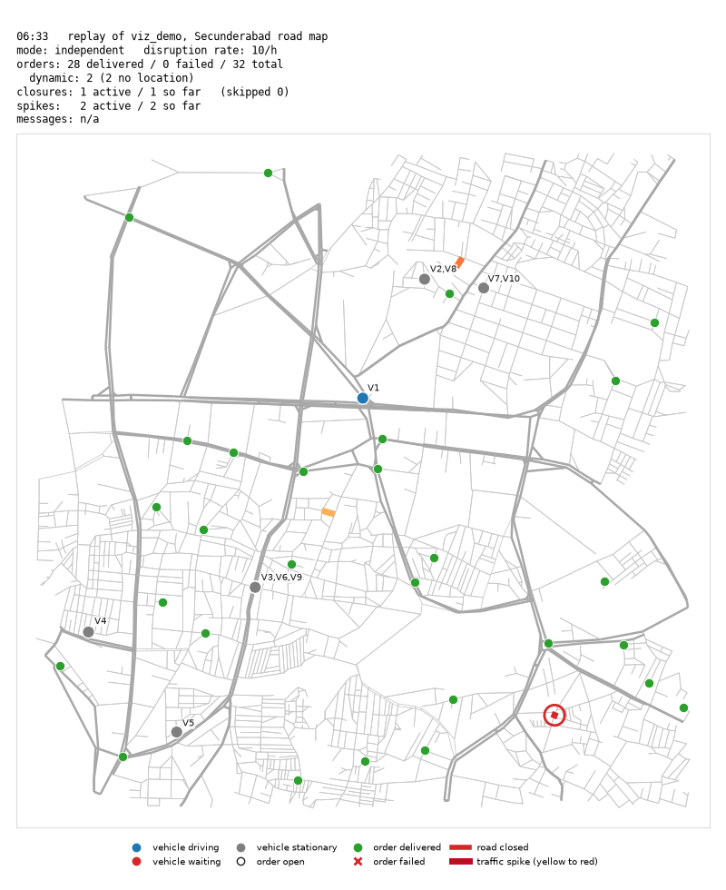

# Replay visualization v1 (R2, Week 4)

`src/viz/replay.py` replays one simulator JSONL log (format: `docs/log_schema.md`)
on the real Secunderabad road graph, as a GIF/MP4 or a single PNG snapshot.



*Snapshot of the `viz_demo` run at 06:33: one closure active (red ring, bottom right),
two traffic spikes (orange segments), V1 driving, the other vehicles stopped.*

## How to run (from the repo root)

```bash
# 1. Build the 10-vehicle demo config (deterministic, writes configs/viz_demo.yaml)
python -m src.viz.demo_scenario --vehicles 10 --orders 30 --seed 7

# 2. Run the simulator (writes logs/viz_demo.jsonl)
python -m src.sim.run --config configs/viz_demo.yaml

# 3. Render the replay (reports/replay/viz_demo.gif, or .mp4 if ffmpeg is on PATH)
#    and/or a snapshot PNG at a given time
python -m src.viz.replay --log logs/viz_demo.jsonl --config configs/viz_demo.yaml
python -m src.viz.replay --log logs/viz_demo.jsonl --config configs/viz_demo.yaml \
    --snapshot-t 06:33 --png docs/replay_example.png
```

Other options: `--step 30` (sim seconds per frame), `--fps 15`, `--dpi 80`,
`--start 06:00 --end 07:00` (HH:MM or seconds from midnight), `--out <path>`,
`--show` (live window instead of a file). `--snapshot-t` without `--out` renders only
the PNG. Rendered files go to `reports/replay/` and are not committed.

## What the colours mean

| Mark | Meaning |
|------|---------|
| light grey lines (thicker for motorway/trunk/primary/secondary) | road network |
| blue dot | vehicle **driving** |
| red dot | vehicle **waiting** in front of a closed road |
| grey dot | vehicle **stationary** (at a node: serving an order, waiting for a time window, or done) |
| small label next to a dot | vehicle id; vehicles at the same spot share one label, e.g. `V3,V6,V9` |
| hollow black circle | order **open** (released, not yet delivered or failed) |
| filled green circle | order **delivered** |
| red x | order **failed** |
| thick red line + red ring | road **closed** (the ring keeps short edges visible) |
| yellow to red line | traffic **spike**, colour = multiplier from 1.0 (yellow) to `max_spike` (red, default 3.0) |

The HUD above the map shows the sim clock (HH:MM, from `t` in seconds from midnight), run
id, mode, disruption rate (all from the log keys), orders delivered / failed / total,
dynamic orders and how many have no location, closures and spikes active / so far,
closures skipped by the guard, and `messages: n/a`. The legend sits below the map, so
neither covers anything on it.

## State rules (`state_at(events, t, config, graph)`)

`state_at` returns plain data (no matplotlib) so the Week 5 three-pane view can reuse it.
Only events with `event.t <= t` count.

- **Vehicle position.** After an `edge_enter [u, v]` at `t0` with `expected_duration d`,
  the vehicle moves in a straight line from `u` to `v`: fraction `(t - t0) / d`, clamped
  to [0, 1]. After `edge_exit` it sits at `payload.node`. Before its first event it is at
  `current_node` (else `depot_node`) from the config; with no config it is not shown.
- **Vehicle state.** `driving` between `edge_enter` and `edge_exit`; `waiting` if a
  `blocked_wait` happened in the last 60 s and there has been no `edge_enter` since
  (the vehicle is drawn at the start node of the blocked edge); otherwise `stationary`.
- **Closures and spikes** are active while `disruption.t <= t < payload.expiry`.
  A spike carries its edge and `magnitude`.
- **Orders.** Config orders are `not_released` while `t < release_time` (absolute
  seconds, as the simulator compares it with `tw_start`) and are not drawn then; then
  `open`; then `delivered` / `failed` from `order_delivered` / `order_failed` events.
  Orders that appear only in the log take their node from those payloads. `new_order`
  events are counted; they are drawn only if the payload has a `node` key (none do yet).
- **Counters.** delivered, failed, total known orders (config orders + dynamic orders
  seen so far + any other order ids in the log so far), new_orders, undrawn_orders,
  closures active / total so far, spikes active / total so far, closure_skipped so far.

## Measured performance (10-vehicle, 4 h demo)

Measured on this laptop (Windows 11, Python 3.14, matplotlib 3.11, no ffmpeg, so GIF):

| | |
|-|-|
| log | `logs/viz_demo.jsonl`, 2258 events (1095 edge_enter, 31 disruptions: 17 closures and 14 spikes, 5 new_order, 30 delivered, 0 failed) |
| frames | 481 (06:00 to 10:00, `--step 30`) |
| render time | 46.4 s, **0.096 s per frame** (two earlier runs: 47.7 s and 45.6 s) |
| GIF | 1.1 MB at `--dpi 80` (640 x 784 px) |
| snapshot PNG | about 0.2 s, 225 KB at dpi 100 |

`state_at` rescans the event list on every frame. At 2258 events that is cheap; the
time is mostly matplotlib drawing and the GIF writer.

Pillow merges identical consecutive frames into one with a longer duration (once the
vehicles stop, two 30 s frames in the same minute look the same), so the GIF holds 308
frames, not 481. GIF frame times are whole centiseconds, so 1/15 s becomes 60 ms and the
GIF plays in 30.6 s, not 32.1 s (about 5% fast). An MP4 (ffmpeg) does not have this.

## Gaps and assumptions

- **Straight-line motion.** Vehicles and closed/spiked roads are drawn as straight lines
  between node coordinates; the curved OSM road geometry is not used. The base map is
  drawn the same way so vehicles stay on the drawn roads.
- **Dynamic orders are not drawn.** `new_order` payloads have only `order_id` and
  `release_time`, no node (the simulator does not create real orders yet, TODO(R3) in
  `src/sim/events.py`). They are counted in the HUD ("dynamic: n (n no location)").
  If a later log adds `payload.node`, the replay draws them with no code change.
- **Messages n/a.** The log has no agent message events yet; the HUD shows
  `messages: n/a` (TODO(R5/R8) in `hud_text`).
- **Order locations come from the config, not the log.** The log does not say where an
  order is until it is delivered or failed, so open orders need `--config`. Without a
  config only finished orders (and vehicles once they move) are drawn.
- **Vehicle starts come from the config.** Without `--config` a vehicle appears at its
  first event.
- **Single run only.** One log, one map. The three-pane comparison is Week 5;
  `ReplayRenderer(ax, graph)` takes any matplotlib axes, so it can be placed in a pane.
- **`blocked_wait` not seen in the demo.** The closure guard (D11) never closed a road a
  vehicle still needed in this run, so the "waiting" colour appears only in the unit test.
- **Most motion is in the first 41 minutes.** In the demo every vehicle finishes its
  route by about 06:41; after that the replay shows only disruptions starting and ending.
  `--end 07:00` gives a shorter video of the busy part.
- **Which vehicle serves an order.** `demo_scenario.py` plans which orders each vehicle
  visits, but `run.py`'s `assign_orders` gives an order to the *first* vehicle whose
  route passes its node, which can be a different vehicle. Every order is still on its
  assigned vehicle's route (checked when the config is written), so none fall back to
  `not_on_route`.
- **Waiting window.** "Within the last 60 s" is inclusive (`t - t_wait <= 60`), because
  the simulator logs `blocked_wait` every 60 s and `t` is rounded to 2 decimals.
- **"total" for disruptions** in the HUD means "so far" (up to the current frame), not
  the whole run.
